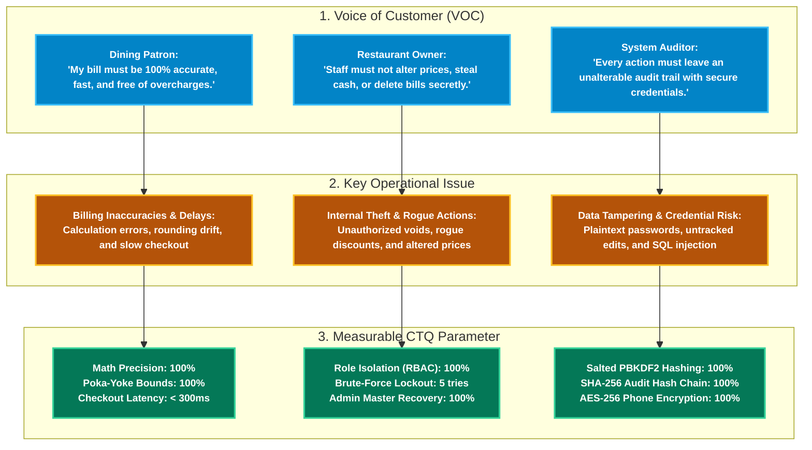
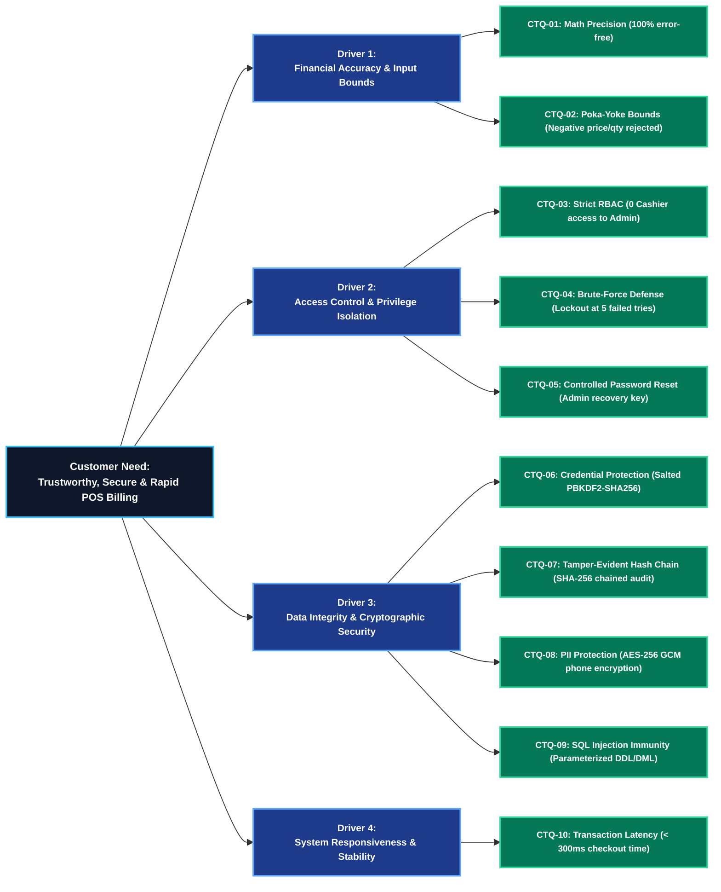

# Critical-to-Quality (CTQ) Requirements & Quality Charter
## Restaurant Billing System — [Q04: Improve Security]
**Course:** BBAT104 — Fundamentals of TQM | **Session:** 2026–27  
**Student Name:** Jatin Palariya  
**University Roll Number:** 2410301034  
**Assigned Topic:** Restaurant Billing System (Digit 4)  
**Assigned Quality Goal:** Q04 — Improve Security (Sequential Allotment)  
**Institution:** Amrapali Institute of Technology & Sciences, Haldwani  

---

## 1. Executive Summary & TQM Context

In Total Quality Management (TQM), **Critical-to-Quality (CTQ)** parameters represent the vital, measurable operational and technical characteristics of a software product that must be satisfied to meet customer expectations and eliminate defects at the source.

For the **Restaurant Billing System with Security Focus (Q04)**, the "Customer" encompasses two key stakeholders:
1. **The Dining Patron (External Customer):** Expects rapid service, zero billing inaccuracies, transparent GST computation, and protection of personal contact data.
2. **The Restaurant Owner / Management (Internal Customer):** Requires absolute protection against internal theft, prevention of unauthorized voids and rogue discounts, tamper-evident audit logging, and protection against unauthorized menu modifications.

---

## 2. Voice of the Customer (VOC) to CTQ Translation

---

## 3. Critical-to-Quality (CTQ) Tree Diagram

---

## 4. Quantitative CTQ Metrics & Acceptance Thresholds

The following 10 measurable parameters govern quality assurance and error-proofing for the project:

| ID | CTQ Parameter | Operational Definition | Target Metric | Minimum Acceptable Threshold | Measurement & Verification Method |
| :---: | :--- | :--- | :---: | :---: | :--- |
| **CTQ-01** | **Billing Math Accuracy** | Subtotal, 5% GST, itemized totals, and grand total computation across orders | **100.0%** error-free | 100.0% | Automated unit tests comparing computed values against fixed benchmark totals. |
| **CTQ-02** | **Poka-Yoke Input Rejection** | Interception of negative quantities, negative prices, empty item names, and excessive discounts (>20%) | **100.0%** rejected | 100.0% | Poka-yoke validator boundary test suite (`test_security.py`). |
| **CTQ-03** | **Role Separation (RBAC)** | Cashiers attempting to access Admin functions (Menu Catalog, Staff Reset, Audit Logs) | **0.0%** unauthorized access | 0.0% | Role-based GUI boundary tests enforcing strict view restriction. |
| **CTQ-04** | **Brute-Force Account Defense** | Lockout triggered upon consecutive failed login attempts on any single account | Lock at **5 attempts** for 60s | Lock at exactly 5 attempts | Automated authentication test loop verifying lockout counter and timeout. |
| **CTQ-05** | **Controlled Password Reset** | Master Recovery Key validation for Admin; mandatory password change flag on staff reset | **100.0%** enforced | 100.0% | Password reset workflow testing (`must_change_password` flag verification). |
| **CTQ-06** | **Credential Storage Security** | Passwords stored using PBKDF2-HMAC-SHA256 with 16-byte random salt and >= 100,000 iterations | **100.0%** hashed; 0% plaintext | 100.0% hashed | Direct SQLite inspection of `users` table verifying no plaintext passwords. |
| **CTQ-07** | **Audit Hash Chain Integrity** | SHA-256 cryptographic chaining between consecutive audit records ($H_n = \text{SHA256}(H_{n-1} \parallel R_n)$) | **100.0%** valid chain | 100.0% valid | Audit verification utility recalculating sequential hashes across all rows. |
| **CTQ-08** | **Customer PII Protection** | Optional customer phone numbers encrypted at rest using AES-256 GCM | **100.0%** ciphertext | 100.0% ciphertext | Database inspection verifying encrypted blob in `bills.customer_phone`. |
| **CTQ-09** | **SQL Injection Immunity** | System immunity against SQL injection payloads (`' OR 1=1;--`, `' UNION SELECT ...`) | **100.0%** immunity | 100.0% immunity | Security payload fuzz tests across login inputs, search filters, and item fields. |
| **CTQ-10** | **Transaction Latency** | Elapsed time from cashier clicking "Confirm Checkout" to receipt display and DB commit | **< 300 ms** | < 1,000 ms | Benchmark timing script profiling checkout execution across 100 simulated orders. |

---

## 5. Review-Wise CTQ Attainment Roadmap

- **Review 1 (Setup & SRS):** Establish the CTQ quality charter, VOC translation tree, and quantifiable acceptance thresholds.
- **Review 2 (Base System & CRUD):** Validate CTQ-01 through CTQ-10 through unit tests, schema constraints, and GUI validation.
- **Review 3 (FMEA & Risk Audit):** Use CTQ thresholds to determine Failure Modes, Severity ratings, and Occurrence probabilities in the FMEA matrix.
- **Review 4 (SQC & Continuous Improvement):** Track any CTQ boundary violations on Checksheets and perform Pareto 80/20 analysis for continuous refinement.
- **Final Viva Voce:** Demonstrate live automated verification of CTQ-01, CTQ-02, CTQ-03, CTQ-06, and CTQ-07 before the examination committee.
