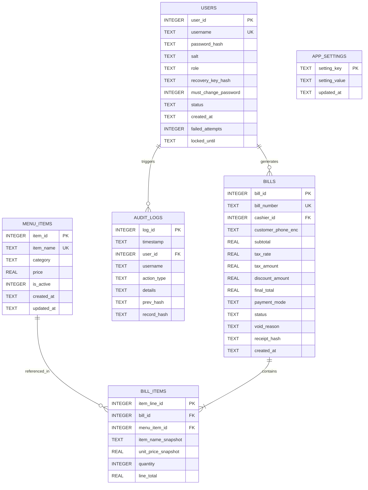

# Database Design & Entity-Relationship (ER) Specification
## Restaurant Billing System — [Q04: Improve Security]
**Course:** BBAT104 — Fundamentals of TQM | **Session:** 2026–27  
**Student:** Jatin Palariya (`2410301034`)  
**Institution:** Amrapali Institute of Technology & Sciences, Haldwani  

---

## 1. Database Overview & Technology Rationale
- **Database Engine:** SQLite 3 (version 3.35+)
- **Storage Mode:** Local relational disk file (`restaurant_pos.db`)
- **Integrity Enforcement:** Foreign key constraints enabled automatically on every connection:
  ```sql
  PRAGMA foreign_keys = ON;
  PRAGMA journal_mode = WAL; -- Write-Ahead Logging for concurrency & durability
  ```
- **Security Principles:**
  - Zero plaintext passwords stored (100% PBKDF2-HMAC-SHA256 hashed).
  - Explicit parameter binding (`?`) across all SQL statements to eliminate SQL injection vulnerabilities.
  - Soft deactivation for menu catalog items to maintain referential integrity with past invoices.
  - Cryptographic hash-chaining across audit log records.

---

## 2. Entity-Relationship (ER) Diagram



---

## 3. Relational Schema & SQL DDL Specification
The executable schema definitions are maintained in [`schema/schema.sql`](file:///d:/COURSES/TQM-project/schema/schema.sql), with initial seed data in [`schema/seed.sql`](file:///d:/COURSES/TQM-project/schema/seed.sql). At runtime, the active SQLite file is stored at `db/restaurant_pos.db`.

### 3.1 `users` Table (Authentication & Access Control)
Stores user credentials, access privileges, Master Recovery Key hash, and account lockout tracking.

```sql
CREATE TABLE IF NOT EXISTS users (
    user_id INTEGER PRIMARY KEY AUTOINCREMENT,
    username TEXT UNIQUE NOT NULL,
    password_hash TEXT NOT NULL,         -- 64-char hex string (PBKDF2-HMAC-SHA256)
    salt TEXT NOT NULL,                  -- 32-char hex string (16 bytes random salt)
    role TEXT NOT NULL CHECK(role IN ('Admin', 'Cashier')),
    recovery_key_hash TEXT DEFAULT NULL, -- Salted hash of Admin Master Recovery Key
    must_change_password INTEGER NOT NULL DEFAULT 0 CHECK(must_change_password IN (0, 1)),
    status TEXT NOT NULL DEFAULT 'Active' CHECK(status IN ('Active', 'Inactive', 'Locked')),
    failed_attempts INTEGER NOT NULL DEFAULT 0,
    locked_until TEXT DEFAULT NULL,       -- ISO-8601 timestamp or NULL
    created_at TEXT NOT NULL DEFAULT (DATETIME('now', 'localtime'))
);

CREATE INDEX IF NOT EXISTS idx_users_username ON users(username);
```

---

### 3.2 `menu_items` Table (Product Catalog)
Maintains food and beverage items. Implements soft-deletion via `is_active` to protect historical invoice associations.

```sql
CREATE TABLE IF NOT EXISTS menu_items (
    item_id INTEGER PRIMARY KEY AUTOINCREMENT,
    item_name TEXT UNIQUE NOT NULL,
    category TEXT NOT NULL CHECK(category IN ('Beverages', 'Starters', 'Main Course', 'Desserts', 'Breads & Rice')),
    price REAL NOT NULL CHECK(price > 0.0), -- Poka-Yoke non-negative constraint
    is_active INTEGER NOT NULL DEFAULT 1 CHECK(is_active IN (0, 1)),
    created_at TEXT NOT NULL DEFAULT (DATETIME('now', 'localtime')),
    updated_at TEXT NOT NULL DEFAULT (DATETIME('now', 'localtime'))
);

CREATE INDEX IF NOT EXISTS idx_menu_category ON menu_items(category);
CREATE INDEX IF NOT EXISTS idx_menu_active ON menu_items(is_active);
```

---

### 3.3 `bills` Table (Invoices Header)
Captures transaction headers, cashier attribution, financial totals, GST, status, and receipt integrity checksums.

```sql
CREATE TABLE IF NOT EXISTS bills (
    bill_id INTEGER PRIMARY KEY AUTOINCREMENT,
    bill_number TEXT UNIQUE NOT NULL,    -- E.g., 'BILL-20261011-0001'
    cashier_id INTEGER NOT NULL,
    customer_phone_enc TEXT DEFAULT NULL, -- AES/Fernet encrypted customer phone number at rest
    subtotal REAL NOT NULL CHECK(subtotal >= 0.0),
    tax_rate REAL NOT NULL DEFAULT 0.05 CHECK(tax_rate >= 0.0), -- Default 5% GST assumption
    tax_amount REAL NOT NULL CHECK(tax_amount >= 0.0),
    discount_amount REAL NOT NULL DEFAULT 0.0 CHECK(discount_amount >= 0.0),
    final_total REAL NOT NULL CHECK(final_total >= 0.0),
    payment_mode TEXT NOT NULL DEFAULT 'Cash' CHECK(payment_mode IN ('Cash', 'Card', 'UPI')),
    status TEXT NOT NULL DEFAULT 'COMPLETED' CHECK(status IN ('COMPLETED', 'VOID')),
    void_reason TEXT DEFAULT NULL,
    receipt_hash TEXT NOT NULL,          -- HMAC-SHA256 signature for receipt verification
    created_at TEXT NOT NULL DEFAULT (DATETIME('now', 'localtime')),
    FOREIGN KEY (cashier_id) REFERENCES users(user_id) ON DELETE RESTRICT
);

CREATE INDEX IF NOT EXISTS idx_bills_number ON bills(bill_number);
CREATE INDEX IF NOT EXISTS idx_bills_cashier ON bills(cashier_id);
CREATE INDEX IF NOT EXISTS idx_bills_date ON bills(created_at);
```

---

### 3.4 `bill_items` Table (Invoice Line Items)
Records individual line items purchased under a bill. Stores immutable item name and price snapshots so future menu price modifications never retroactively alter past bills.

```sql
CREATE TABLE IF NOT EXISTS bill_items (
    item_line_id INTEGER PRIMARY KEY AUTOINCREMENT,
    bill_id INTEGER NOT NULL,
    menu_item_id INTEGER NOT NULL,
    item_name_snapshot TEXT NOT NULL,
    unit_price_snapshot REAL NOT NULL CHECK(unit_price_snapshot > 0.0),
    quantity INTEGER NOT NULL CHECK(quantity > 0), -- Poka-Yoke positive quantity guard
    line_total REAL NOT NULL CHECK(line_total > 0.0),
    FOREIGN KEY (bill_id) REFERENCES bills(bill_id) ON DELETE CASCADE,
    FOREIGN KEY (menu_item_id) REFERENCES menu_items(item_id) ON DELETE RESTRICT
);

CREATE INDEX IF NOT EXISTS idx_bill_items_bill ON bill_items(bill_id);
```

---

### 3.5 `audit_logs` Table (Immutable Event Log with Hash Chaining)
Captures every critical system event. Enforces cryptographic hash-chaining by referencing the SHA-256 hash of the immediately preceding record.

```sql
CREATE TABLE IF NOT EXISTS audit_logs (
    log_id INTEGER PRIMARY KEY AUTOINCREMENT,
    timestamp TEXT NOT NULL DEFAULT (DATETIME('now', 'localtime')),
    user_id INTEGER,                     -- NULL allowed for failed login attempts by unknown users
    username TEXT NOT NULL,
    action_type TEXT NOT NULL CHECK(action_type IN (
        'USER_LOGIN_SUCCESS',
        'USER_LOGIN_FAILED',
        'USER_LOGOUT',
        'ACCOUNT_LOCKED',
        'PASSWORD_RESET',
        'MENU_ITEM_ADDED',
        'MENU_ITEM_UPDATED',
        'MENU_ITEM_DEACTIVATED',
        'BILL_GENERATED',
        'BILL_VOIDED',
        'INTEGRITY_CHECK_RUN'
    )),
    details TEXT NOT NULL,
    prev_hash TEXT NOT NULL,             -- SHA-256 hex of record (log_id - 1); 'GENESIS_HASH' for log_id 1
    record_hash TEXT NOT NULL            -- SHA-256 hex(log_id || timestamp || username || action_type || details || prev_hash)
);

CREATE INDEX IF NOT EXISTS idx_audit_timestamp ON audit_logs(timestamp);
```

---

### 3.6 `app_settings` Table (Configurable Parameters)
Stores configurable system settings such as default tax rate and restaurant header information, preventing hard-coded operational assumptions.

```sql
CREATE TABLE IF NOT EXISTS app_settings (
    setting_key TEXT PRIMARY KEY,
    setting_value TEXT NOT NULL,
    updated_at TEXT NOT NULL DEFAULT (DATETIME('now', 'localtime'))
);
```

---

## 4. Default Seed Data (Pre-Populated Baseline)

### 4.1 Account Provisioning & First-Time Setup
- **First-Time Setup Wizard:**
  - Upon first launch when the `users` table contains zero records, the application presents a one-time setup dialog.
  - The user creates the primary **Administrator** credentials (Username, strong Password) and sets an **Admin Master Recovery Key** (used for emergency Admin password reset).
  - Credentials are immediately hashed using PBKDF2-HMAC-SHA256 with a CSPRNG salt.
- **Cashier Account Creation:**
  - Cashiers cannot self-register; they are created by an authenticated Administrator from the User Management panel.
  - Newly created staff accounts have `must_change_password = 1`, forcing the Cashier to set their own private password upon their first login.
- **Demo Seeding Mode (`--seed-demo`):**
  - For academic grading and evaluator convenience, running the app with `--seed-demo` pre-populates temporary demo credentials (`admin` / `Admin@1234` and `cashier1` / `Cashier@1234`) with `must_change_password = 1`.

### 4.2 Initial Menu Catalog Items
| Item ID | Item Name | Category | Unit Price (INR) | Status |
| :---: | :--- | :--- | :---: | :---: |
| 1 | Masala Chai | Beverages | ₹ 30.00 | Active |
| 2 | Cold Coffee | Beverages | ₹ 80.00 | Active |
| 3 | Paneer Tikka | Starters | ₹ 220.00 | Active |
| 4 | Veg Spring Rolls | Starters | ₹ 150.00 | Active |
| 5 | Dal Makhani | Main Course | ₹ 240.00 | Active |
| 6 | Butter Paneer Masala | Main Course | ₹ 280.00 | Active |
| 7 | Tandoori Roti | Breads & Rice | ₹ 20.00 | Active |
| 8 | Butter Naan | Breads & Rice | ₹ 45.00 | Active |
| 9 | Jeera Rice | Breads & Rice | ₹ 140.00 | Active |
| 10 | Gulab Jamun (2 pcs) | Desserts | ₹ 70.00 | Active |

### 4.3 Default System Settings
- `tax_rate`: `'0.05'` (5.0% default assumption, configurable by Administrator)
- `restaurant_name`: `'Amrapali Campus Diner'`
- `currency_symbol`: `'₹'`

---

## 5. Data Integrity & Poka-Yoke Validation Constraints
1. **CHECK Constraints:** Hard boundaries on numeric prices ($> 0$), quantities ($> 0$), and tax rates ($\ge 0$).
2. **Foreign Key Integrity:** `bill_items` cascade delete only if an unfinalized draft bill is purged; confirmed bills are never deleted, only marked `VOID`.
3. **Historical Preservation:** Historical invoices snapshot the item name and unit price at the time of purchase, preventing price skew if the admin later updates menu prices.
4. **Hash Chain Verification:** The system implements an integrity verification algorithm:
   $$\text{Hash}_n = \text{SHA256}(\text{log\_id}_n \parallel \text{timestamp}_n \parallel \text{username}_n \parallel \text{action}_n \parallel \text{details}_n \parallel \text{Hash}_{n-1})$$
   Any modification of previous logs will cause a mismatch during verification.
