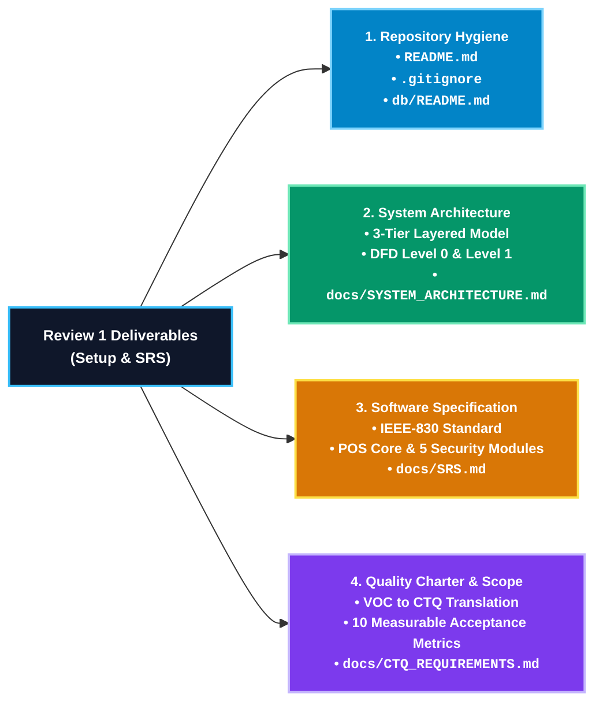

# Academic Review Deliverables Roadmap
## Restaurant Billing System — [Q04: Improve Security]
**Course:** BBAT104 — Fundamentals of TQM | **Academic Session:** 2026–27  
**Student Name:** Jatin Palariya  
**University Roll Number:** 2410301034  
**Assigned Baseline System:** Restaurant Billing System (Digit 4)  
**Assigned Quality Goal:** Q04 — Improve Security (Sequential Allotment)  
**Institution:** Amrapali Institute of Technology & Sciences, Haldwani  

---

## 1. Review 1 Deliverables Architecture

The diagram below outlines the core deliverables prepared and submitted for **Review 1 (Setup & SRS)**:

---

## 2. Review 1 Deliverables Summary

1. **Repository Initialization & Git Hygiene:**
   - Public version-controlled repository on GitHub.
   - Security-focused `.gitignore` strictly excluding SQLite `.db` binaries, encryption keys, and cache files.
   - Directory structure isolating `config/`, `db/`, `docs/`, `schema/`, `src/`, and `tests/`.

2. **System Architecture & Modeling (`docs/SYSTEM_ARCHITECTURE.md`):**
   - Layered 3-tier architecture (Presentation GUI, Business Logic & Security, SQLite Persistence).
   - Data Flow Diagrams (DFD Level 0 and Level 1).
   - Component interaction and data sanitization flowcharts.

3. **Software Requirements Specification (`docs/SRS.md`):**
   - IEEE-830 standard software requirements specification.
   - Functional requirements for core POS operations (`FR-01` to `FR-04`).
   - Detailed functional specifications for the 5 assigned Q04 security modules (`FR-05` to `FR-09`).

4. **Scope Boundaries & CTQ Parameters (`docs/CTQ_REQUIREMENTS.md`):**
   - Voice of the Customer (VOC) translation into Critical-to-Quality parameters.
   - CTQ Tree diagram and 10 quantitative acceptance thresholds.
   - Explicit In-Scope vs. Out-of-Scope boundary definitions.

---

## 3. Upcoming Implementation Scope (Review 2 Preview)

*Targeted for subsequent development following Review 1 evaluation:*

| Module / Component | Target Files | Functional Scope |
| :--- | :--- | :--- |
| **Base CRUD: Menu Catalog** | `src/menu/` | Add, edit, search, and deactivate menu items; custom categories. |
| **Base CRUD: Cart & Billing** | `src/billing/` | Dynamic item addition, 5% GST computation, subtotal, and receipt generation. |
| **Q04 Feature 1: Role-Based Access** | `src/auth/` | Admin vs. Cashier session isolation with restricted GUI views. |
| **Q04 Feature 2: Password Reset** | `src/auth/` | Admin Master Recovery Key reset and staff reset with forced password change. |
| **Q04 Feature 3: Poka-Yoke Validation** | `src/security/validators.py` | Defense against negative prices/quantities, invalid phone numbers, and SQL injection. |
| **Q04 Feature 4: Tamper-Evident Audit** | `src/audit/logger.py` | Append-only event logging with cryptographic SHA-256 hash chaining. |
| **Q04 Feature 5: Encryption & Protection** | `src/security/crypto.py` | Salted PBKDF2 password hashing, AES-256 customer phone encryption, receipt HMAC. |
