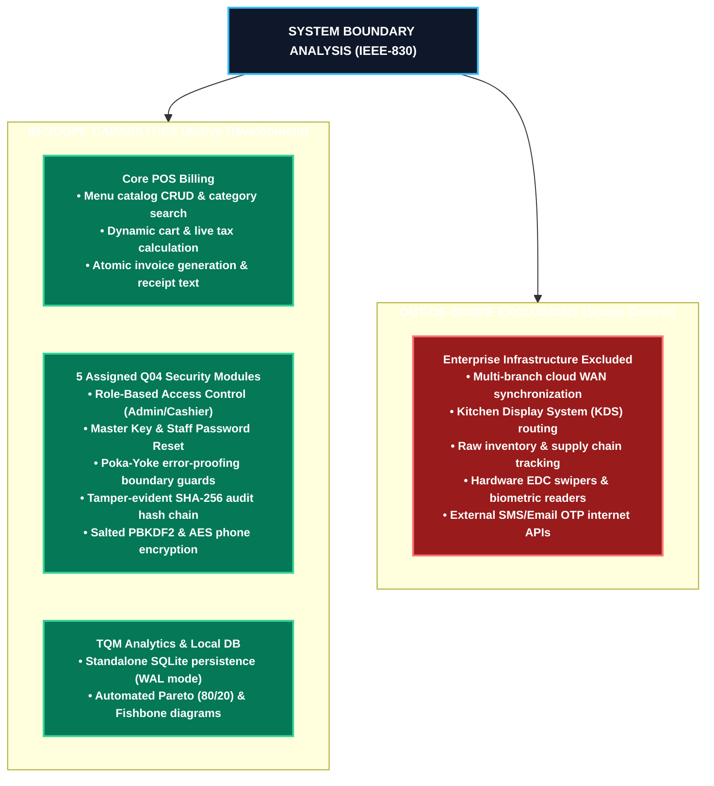
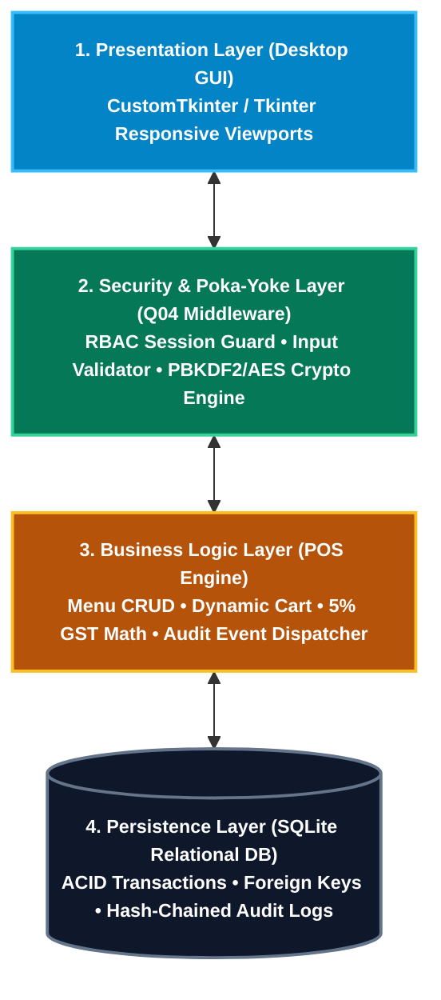
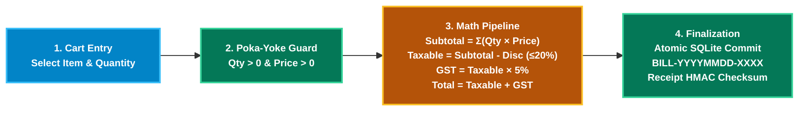
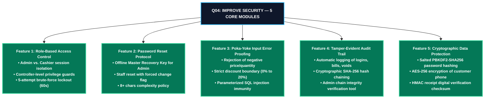
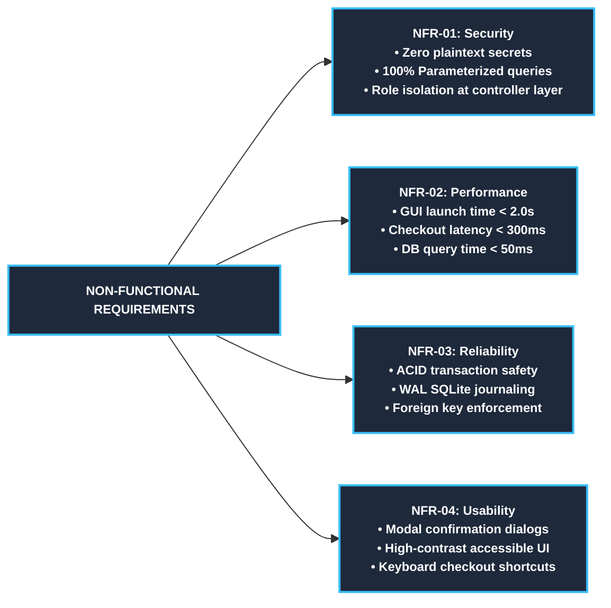

# Software Requirements Specification (SRS)
## Restaurant Billing System — [Q04: Improve Security]
**Course:** BBAT104 — Fundamentals of Total Quality Management (TQM)  
**Academic Session:** 2026–27  
**Student Name:** Jatin Palariya (`2410301034`)  
**Assigned Topic:** Restaurant Billing System (Digit 4) | **Quality Goal:** Q04 — Improve Security  
**Institution:** Amrapali Institute of Technology & Sciences, Haldwani  
**Standard:** IEEE-830 Recommended Practice for Software Requirements Specifications  

---

## 1. Scope & System Boundaries

---

## 2. Product Architecture & Layered Design

---

## 3. Order Processing & Billing Computation Pipeline

---

## 4. Security Architecture & 5 Assigned Q04 Features

---

## 5. Functional Requirements (IEEE-830 Specifications)

### 5.1 Baseline POS Modules
| Req ID | Module | Functional Description | Acceptance Rule |
| :--- | :--- | :--- | :--- |
| **FR-01** | **Menu Catalog CRUD** | Add, edit, search, and deactivate menu items across categories (Starters, Main, Beverages, Desserts). | Soft deactivation toggles `is_active=0`; hard delete is blocked if sales exist. |
| **FR-02** | **Dynamic Order Cart** | Add items, increment/decrement quantities, remove line items, and clear cart. | Cart quantity must be strictly positive; real-time recalculation of all figures. |
| **FR-03** | **Live Billing Math** | Compute Line Totals, Subtotal, Bounded Discounts (0–20%), 5% GST, and Grand Total. | Zero rounding discrepancies; calculations match unit benchmark values. |
| **FR-04** | **Invoicing & History** | Finalize bill with unique ID (`BILL-YYYYMMDD-XXXX`), print receipt text, and view sales history. | Atomic multi-table write (`bills` & `bill_items`) with rollback protection. |

### 5.2 Q04 Security Modules
| Req ID | Security Feature | Technical Specification | Security Rule |
| :--- | :--- | :--- | :--- |
| **SEC-01** | **Role-Based Login** | Authenticate users against salted hashes; assign `Admin` or `Cashier` session privileges. | 0% cashier access to menu edits, user resets, audit logs, or bill voids. |
| **SEC-02** | **Brute-Force Defense** | Track consecutive invalid attempts; trigger temporary account lock. | Account locks for 60 seconds upon exactly 5 consecutive failed logins. |
| **SEC-03** | **Password Reset** | Offline Master Recovery Key for Admin; Admin-managed staff reset. | Staff reset flags `must_change_password=1`, forcing immediate password change. |
| **SEC-04** | **Poka-Yoke Bounds** | Boundary validation intercepting illegal quantities, negative prices, and bad formats. | Reject $Qty \le 0$, $Price \le 0.00$, and discount $> 20\%$ with modal alert. |
| **SEC-05** | **Audit Hash Chain** | Append-only event capture linked via SHA-256: $H_n = \text{SHA256}(H_{n-1} \parallel R_n)$. | Any row tampering or out-of-band deletion breaks the cryptographic chain. |
| **SEC-06** | **Credential Storage** | Derived key storage using PBKDF2-HMAC-SHA256 with 16-byte random salt. | 100,000 iterations; zero plaintext passwords in database or memory dumps. |
| **SEC-07** | **Phone Data Encryption** | Optional customer phone numbers encrypted symmetrically at rest via AES (Fernet). | Ciphertext stored in SQLite; decrypted only upon authorized invoice view. |
| **SEC-08** | **Receipt Checksum** | Digital signature calculated over Bill ID, timestamp, and grand total. | HMAC-SHA256 signature guarantees receipt cannot be altered or falsified. |

---

## 6. Non-Functional Requirements (NFR)

---

## 7. Review 1 Acceptance Baseline

This specification serves as the formal baseline submitted for academic evaluation under Review 1:
1. Complete alignment with BBAT104 course guidelines and project allotment (Digit 4 / Q04).
2. Full functional coverage of baseline Restaurant Billing System and all 5 Q04 Security Features.
3. Architecture, scope definitions, and database models fully synchronized with this requirements specification.
