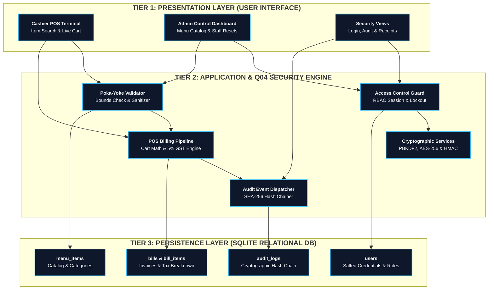
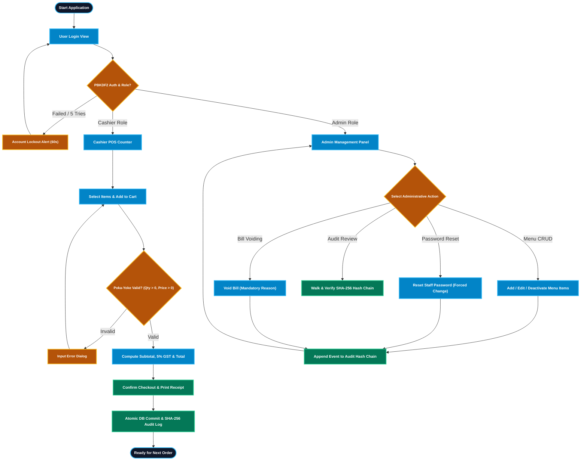
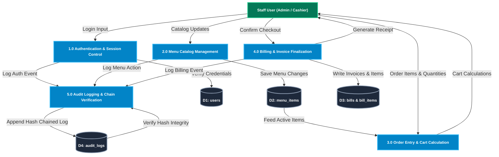

# System Architecture & Flowchart
## Restaurant Billing System — [Q04: Improve Security]
**Course:** BBAT104 — Fundamentals of TQM | **Session:** 2026–27  
**Student Name:** Jatin Palariya (`2410301034`)  
**Assigned Topic:** Restaurant Billing System (Digit 4) | **Quality Goal:** Q04 — Improve Security  
**Institution:** Amrapali Institute of Technology & Sciences, Haldwani  

---

## 1. Professional 3-Tier System Architecture

The software architecture follows an industry-standard 3-Tier model ensuring loose coupling, high cohesion, and strict privilege isolation:

---

## 2. High-Level Process Flowchart

---

## 3. Data Flow Diagrams (DFD)

### 3.1 DFD Level 0: Context Diagram

### 3.2 DFD Level 1: Subsystem Processing

---

## 4. Security Architecture & Threat Mitigation Matrix

| Threat Category | Potential Risk / Attack | Mitigating Architectural Component | Verification Technique |
| :--- | :--- | :--- | :--- |
| **Credential Exposure** | Stolen database file with exposed passwords | PBKDF2-HMAC-SHA256 (100k iterations, 16-byte random salt). | Direct SQLite query confirming zero plaintext credentials. |
| **SQL Injection (SQLi)** | Malicious SQL syntax in search/login inputs (`' OR 1=1;--`) | 100% Parameterized queries (`?` parameter bindings). | Security payload test suite rejected safely. |
| **Privilege Escalation** | Cashier attempting to edit menu prices or void bills | Strict RBAC enforced at GUI controller and DB layers. | Automated role privilege boundary tests. |
| **Input Corruption** | Negative quantities, negative prices, excessive discounts | Poka-Yoke boundary guards ($Qty > 0$, $Price > 0$, $Disc \le 20\%$). | Boundary value input test suite. |
| **Audit Log Tampering** | Rogue actor altering or deleting audit records | Append-only audit table with SHA-256 cryptographic chaining. | Hash-chain verification tool recalculates sequential hashes. |
| **Customer Data Breach** | Unauthorized viewing of patron contact numbers | AES-256 symmetric encryption for optional customer phone numbers. | SQLite inspection confirming ciphertext blob at rest. |
| **Invoice Alteration** | Tampering with stored or reprinted bill amounts | HMAC-SHA256 digital receipt checksum over bill number & total. | Checksum validator flags altered bill figures immediately. |
